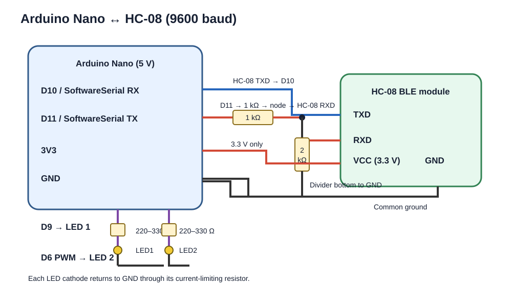

# Bluetooth (HC-08) proof of concept

## Hardware

- Arduino Nano
- HC-08 Bluetooth Low Energy (BLE) module
- Two LEDs, each with a current-limiting resistor (for example 220–330 Ω)
- 1 kΩ and 2 kΩ resistors for the Arduino-to-HC-08 logic-level divider
- A phone with a BLE UART/serial-terminal app

## Wiring

Use the software serial pins so the Nano's D0/D1 USB serial pins remain free:

| Arduino Nano | Connect to |
| --- | --- |
| D10 (SoftwareSerial RX) | HC-08 TXD |
| D11 (SoftwareSerial TX) | HC-08 RXD through the 1 kΩ / 2 kΩ voltage divider shown below |
| 3V3 | HC-08 VCC |
| GND | HC-08 GND and the bottom of the divider |
| D9 | LED 1 anode; LED cathode through its resistor to GND |
| D6 (PWM) | LED 2 anode; LED cathode through its resistor to GND |

The divider is on the Nano's 5 V TX signal: D11 → 1 kΩ → divider node → HC-08 RXD, with 2 kΩ from the divider node to GND. Connect all grounds together. Power the HC-08 from 3.3 V, as in the checked build.

The SVG above is the wiring reference for this sketch. The older `SCH_LineFollower1_2026-10-23 (1).json` export is a legacy project schematic and does not show this Bluetooth/LED setup; do not use that export to wire this proof of concept.

## Commands and duplex test

Set the HC-08 UART baud rate to 9600. Pair/connect from a BLE UART app and send newline-terminated commands:

- `ON` — turn LED 1 on.
- `OFF` — turn LED 1 off.
- `PWM 128` — set LED 2 brightness to a value from 0 to 255.
- `STATUS` — request the current LED state.

The Arduino sends a Bluetooth reply for every command, including an error reply for unrecognized or invalid commands. This demonstrates communication in both directions. The sketch also logs replies to the USB serial monitor at 9600 baud.

> HC-08 is a BLE module, not an HC-05 classic Bluetooth module. Use a BLE UART/terminal app; a classic-Bluetooth-only terminal app may not connect.
